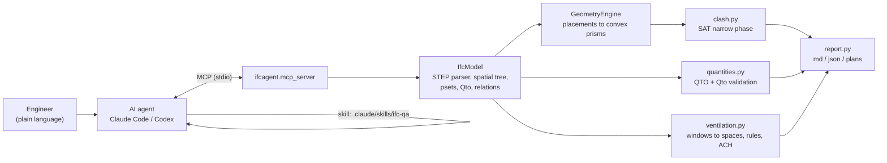
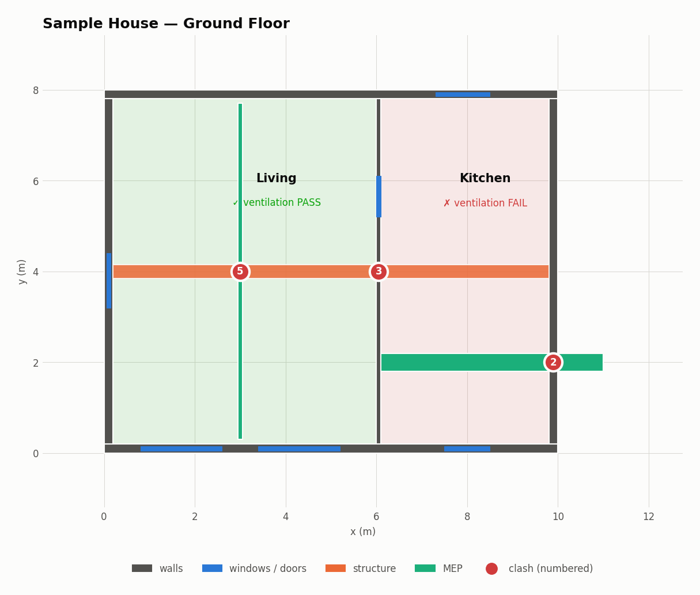
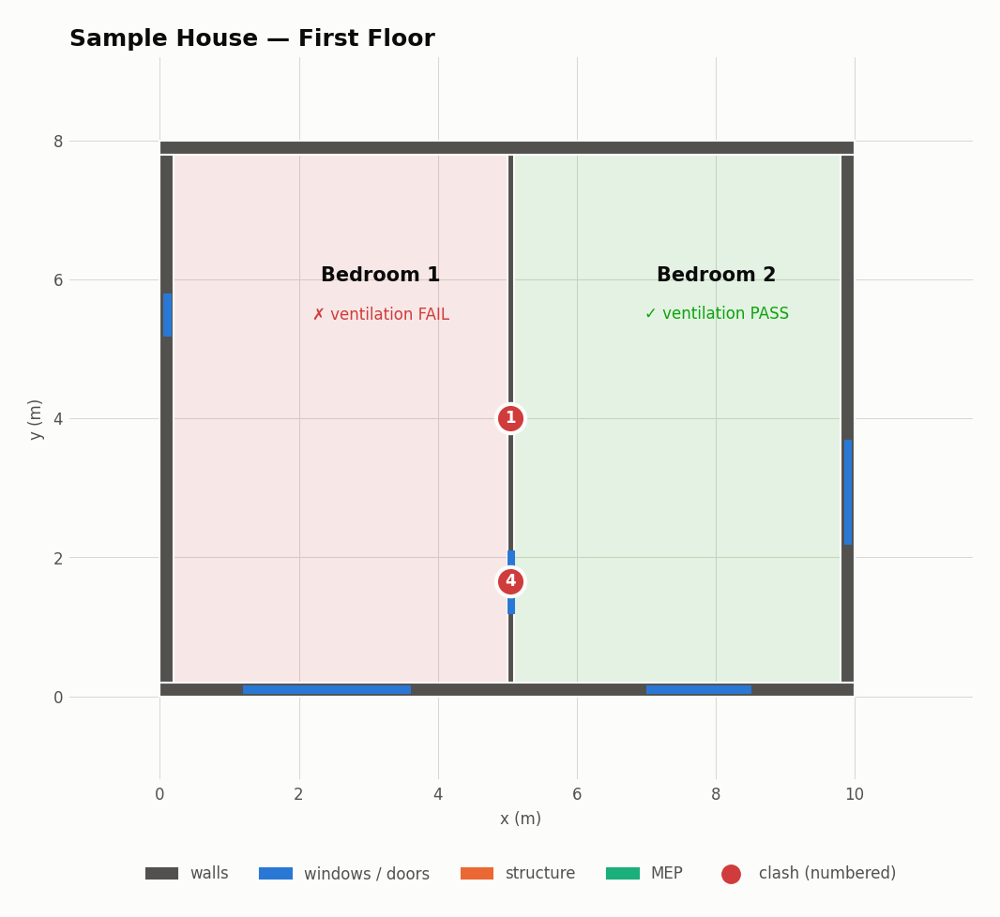

# ifc-agent-tools

**Give an AI agent reliable hands for BIM.** A small, dependency-light Python toolkit that reads IFC models and does
quantity take-off, clash detection, validation of authored quantities, and natural-ventilation screening. It is
exposed as an **MCP server** and a **Claude Code skill**, so Claude Code, Codex or any MCP client can run a
coordination review of an `.ifc` file from a plain-language request.

```
> Run a coordination review of examples/sample_house.ifc and tell me what to fix first.
```

LLMs are good at planning a review and explaining the findings. They are bad at computing whether a 400×300 duct
crosses a 200 mm wall. This repo puts the geometry and the counting in deterministic, tested tools, and leaves the
agent to decide which tools to call and how to read the results.

---

## What the agent gets

| MCP tool | What it does |
|---|---|
| `model_summary` | schema, units, storeys, element counts, and a list of any geometry that could only be approximated |
| `list_elements` / `get_element` | filter by class, storey or name; full detail with psets, Qto sets, host wall, bounding box |
| `quantity_takeoff` | QTO **computed from geometry**: wall length/height/width, gross and net side area, net volume with openings deducted; slab area and thickness; member length; window/door area |
| `space_schedule` | room schedule (floor area, height, volume) |
| `validate_quantities` | compares **authored** `IfcElementQuantity` values (e.g. `Qto_WallBaseQuantities`) with geometry and flags stale ones |
| `detect_clashes` | hard, clearance and duplicate clashes using an **exact** separating-axis test on convex solids; group A vs group B; contact tolerance; hosted windows/doors and assembly parts excluded |
| `check_natural_ventilation` | finds the exterior windows serving each `IfcSpace`, gets openable area from window-type panel operations, and checks it against **HK B(P)R 30/31** (glazing ≥ 1/10 of floor area, openable ≥ 1/16) or other rule sets; applies CIBSE room-depth rules and gives an indicative BS 5925 air-change rate |
| `write_qa_report` | runs every check and writes `report.md`, `report.json` and an annotated plan per storey |

The same functions work without an agent: `python -m ifcagent <summary|qto|validate|clash|ventilation|report> model.ifc`.

## Architecture



* **`step.py`**: an ISO 10303-21 tokenizer and parser (strings, `\X2\` unicode, typed values, complex entities).
* **`geometry.py`**: resolves `IfcLocalPlacement` chains and turns bodies into convex prisms. It handles extrusions
  (rectangle, circle, I-shape, arbitrary polyline including concave outlines via ear clipping), swept disks,
  mapped items and bounding boxes exactly. Boolean clippings and B-rep/tessellated meshes are bounded
  conservatively and flagged, never dropped silently.
* **`clash.py`**: sweep-and-prune broad phase, then a Separating Axis Test (face normals plus edge-by-edge cross
  products). For convex polyhedra this gives the true penetration depth, not just a yes/no answer.

The only runtime dependency is `numpy`. `mcp` is needed for the server and `matplotlib` for the plan images. There
is no CAD kernel and no `ifcopenshell`, so it installs anywhere, including sandboxed agent environments.

## Quick start

```bash
git clone https://github.com/<masoodkaramoozian>/ifc-agent-tools && cd ifc-agent-tools
pip install -r requirements.txt

python examples/generate_sample.py                 # writes examples/sample_house.ifc
python -m ifcagent report examples/sample_house.ifc -o sample_report
python -m unittest discover -s tests -v            # 16 tests
python examples/mcp_demo.py                        # real MCP stdio round trip, no LLM needed
```

**With Claude Code:** open the repo and run `claude`. It finds `.mcp.json` (the `ifc-agent` server) and the
`ifc-qa` skill. Then just ask, for example:

* *"Which rooms in sample_house.ifc fail natural ventilation, and what is the cheapest fix for each?"*
* *"Check MEP against structure with 50 mm clearance and draft RFIs for the hard clashes."*
* *"Can I trust the wall quantities in this model for a cost estimate?"*

**Other MCP clients** (Codex, Cursor, Claude Desktop) use the same command:
`python -m ifcagent.mcp_server` (or `ifcagent-mcp` after `pip install -e .[all]`).

## Demo: the sample model

`examples/generate_sample.py` writes a two-storey IFC4 house (28 elements, 4 spaces). It contains realistic
coordination errors on purpose, and just as many correct conditions that must **not** be reported (walls on slabs,
windows in their host walls, walls butting at corners).

Full output: [`docs/sample_report/report.md`](docs/sample_report/report.md) · MCP transcript:
[`docs/mcp_demo_output.txt`](docs/mcp_demo_output.txt)

| # | kind | elements | depth / gap | what an engineer would do |
|---|---|---|---|---|
| 1 | duplicate | Wall 1F-INT × Wall 1F-INT (copy) | 100 mm | delete the copy; this also resolves #4 |
| 2 | hard | Duct SA-01 × Wall GF-E | 200 mm | builder's-work opening and sleeve in the facade |
| 3 | hard | Beam B1 × Wall GF-INT | 100 mm | stop the partition at the beam soffit |
| 4 | hard | Door 1F-INT × Wall 1F-INT (copy) | 100 mm | knock-on effect of #1 |
| 5 | clearance | Beam B1 × Pipe CW-01 | 30 mm (< 50) | drop the pipe, or accept with insulation detail |

| space | facades | openable m² (required) | depth m (limit) | result |
|---|---|---|---|---|
| Living | S+W | 3.60 (2.76) | 5.8 (7.5) | PASS |
| Kitchen | N only | 0.72 (1.76) | 7.6 (7.5) | **FAIL**: too little glazing, too deep for single-sided |
| Bedroom 1 | S+W | 0.36 (2.28) | 4.8 (7.5) | **FAIL**: big window, but the picture pane is fixed |
| Bedroom 2 | E+S | 2.25 (2.23) | 4.7 (7.5) | PASS (just) |

The QTO check also catches `Wall GF-N`, whose authored `NetVolume` is 6.60 m³ while the geometry gives
5.712 m³ (+15.5 %). The value is stale, left over from an earlier wall thickness.

<p>


</p>

## Design choices (and where I did not trust the first answer)

* **Exact where it matters, conservative where it can't be exact.** Clipped solids keep their unclipped volume
  (an upper bound), and meshes use their oriented bounding box for clashes. The result carries
  `approximate_geometry: true` so the agent tells the user before raising an RFI.
* **Separation is a lower bound.** Below the contact tolerance, a SAT separation is a lower bound on the true gap.
  That is the safe direction for clearance checks: a borderline pair can show up, but a real violation cannot be
  missed.
* **Openable area is not glazed area.** Bedroom 1 passes the 1/10 glazing rule and fails the 1/16 openable rule. The
  tool reads `IfcWindowPanelProperties.OperationType` (fixed = 0, sliding = 0.5, hinged or pivot = 1). When the model
  has no such data it falls back to an explicit `default_openable_ratio` and marks the result `uses_assumptions`,
  so the missing data stays visible.
* **Tests encode traps**: a column in the notch of an L-shaped slab (its bounding boxes overlap but the solids do not),
  a 45° rotated box (edge-edge axes), millimetre units, a mapped item, a clipped wall and a closed tessellated
  mesh.

## Link to my research

My *Journal of Indoor Air* (2025) paper models how occupants actually open windows in residential green buildings.
This tool gives the physical upper bound, the openable area a room *could* use, straight from the BIM model. The
next step is to feed the behaviour model's opening probabilities into `check_natural_ventilation` to get the
*expected* air change rate per room instead of a best case.

## Limitations & roadmap

* Pure-Python parsing runs at about 4 MB/s (a 2 MB, 3,000-element model parses and clash-checks in about 2 s).
  Very large federated models would need an optional `ifcopenshell` backend.
* Curved B-reps (`IfcAdvancedBrep`) and NURBS are not evaluated. They are reported in `geometry_notes`.
* Windows are assigned to spaces geometrically unless `IfcRelSpaceBoundary` exists, in which case those relations
  are used.
* Next: BCF export of clashes, IDS (Information Delivery Specification) checking, and an ifcopenshell backend
  selectable at runtime.

## How this was built

I built it AI-first, directing Claude (acting as the coding agent) through design, implementation and verification
in one working session. See [`BUILD_LOG.md`](BUILD_LOG.md) for the prompts, the decisions I made, and what was checked
by hand.

MIT licence · Masood Karamoozian · masood.karamoozian@gmail.com
